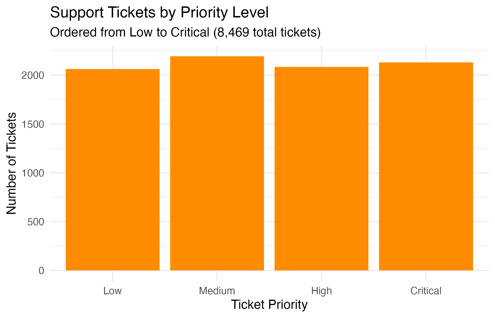
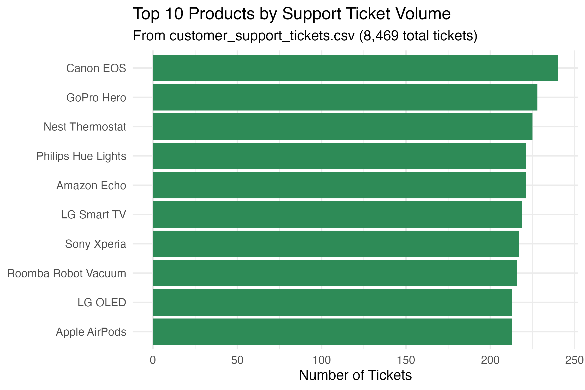

# Customer Support Operations & CSAT Analysis (R)

An end-to-end exploratory data analysis (EDA) of **8,469 customer support tickets** across **17 variables**, designed to identify operational bottlenecks, channel performance gaps, and key drivers of Customer Satisfaction (CSAT).

**Tech Stack:** `R` • `RStudio` • `tidyverse` (`dplyr`, `ggplot2`, `readr`) • `janitor` • `Git / GitHub`

---

## 1. Business Problem (The Why)
High-volume customer support teams manage thousands of incoming requests across multiple channels simultaneously, making it difficult to distinguish isolated complaints from systemic friction. Without structured visibility into ticket drivers and post-resolution satisfaction, operations teams risk misallocating agent capacity and overlooking high-churn pain points.

**Core Questions Investigated:**
* Which issue categories and product lines generate the highest support volume?
* How are incoming tickets distributed across channels and priority tiers?
* Where are Customer Satisfaction (CSAT) scores strongest and weakest across resolved tickets?

---

## 2. Methodology & Data Workflow (The How)
Using a reproducible script (`analysis.R`), raw ticket records from `customer_support_tickets.csv` were processed through a three-stage analytical workflow:

1. **Data Cleaning & Auditing (`janitor`, `dplyr`):**
   * Standardized all 17 column headers into `snake_case` using `janitor::clean_names()`.
   * Audited missingness across `customer_satisfaction_rating`, identifying a key structural rule: **100% of CSAT ratings (2,769 records) belong to Closed tickets**, while the remaining **5,700 Open or Pending tickets** are unrated.
2. **Multi-Dimensional Aggregation (`dplyr`):**
   * Segmented ticket volume and mean/median CSAT across **ticket types**, **support channels**, **priority levels** (ordered logically from *Low* to *Critical* via `factor()`), and **purchased products**.
3. **Data Visualization (`ggplot2`):**
   * Engineered publication-ready bar charts exported at 300 DPI (`tickets_by_channel.png`, `tickets_by_priority.png`, `top_10_products.png`) to communicate demand distribution and product hotspots clearly to non-technical stakeholders.

---

## 3. Key Findings & Recommendations (The What)

| Metric / Dimension | Key Finding | Operational Takeaway |
| :--- | :--- | :--- |
| **Ticket Volume by Type** | **Refund requests (1,752)** and **Technical issues (1,747)** lead volume, followed by Cancellation (1,695), Product (1,641), and Billing (1,634). | Prioritize self-service troubleshooting guides and automated refund tracking to deflect top-volume queues. |
| **CSAT by Issue Type** | Overall mean CSAT is **2.99 / 5.0** (median **3.0**). **Refund requests (2.935)** and **Technical issues (2.959)** score lowest, while **Cancellations (3.029)** and **Billing (3.028)** score highest. | High-volume technical and refund workflows correlate with lower satisfaction and warrant targeted SLA review. |
| **Channel Performance** | Volume is evenly split across **Email (2,143)**, **Phone (2,132)**, **Social Media (2,121)**, and **Chat (2,073)**, yet **Chat leads CSAT at 3.083**. | Real-time resolution on Chat drives higher customer satisfaction; consider routing complex technical inquiries to live chat. |
| **Urgency & Product Hotspots** | **Medium (2,192)** and **Critical (2,129)** tickets represent **51.0%** of total demand. **Canon EOS (240)**, **GoPro Hero (228)**, and **Nest Thermostat (225)** generate the most tickets. | Align specialist agent coverage with high-ticket hardware lines and audit product documentation for top-3 devices. |

---

## 4. Visual Outputs

### Support Tickets by Channel


### Support Tickets by Priority Level


### Top 10 Products by Support Ticket Volume


---

## 5. Repository Structure
```text
support-tickets-r/
├── analysis.R                    # Reproducible R script for cleaning, aggregation, and plotting
├── customer_support_tickets.csv  # Source dataset (8,469 records, 17 variables)
├── tickets_by_channel.png        # Ticket volume distribution across 4 support channels
├── tickets_by_priority.png       # Ticket counts ordered from Low to Critical priority
├── top_10_products.png           # Top 10 products generating customer support volume
└── README.md                     # Project documentation and executive summary
