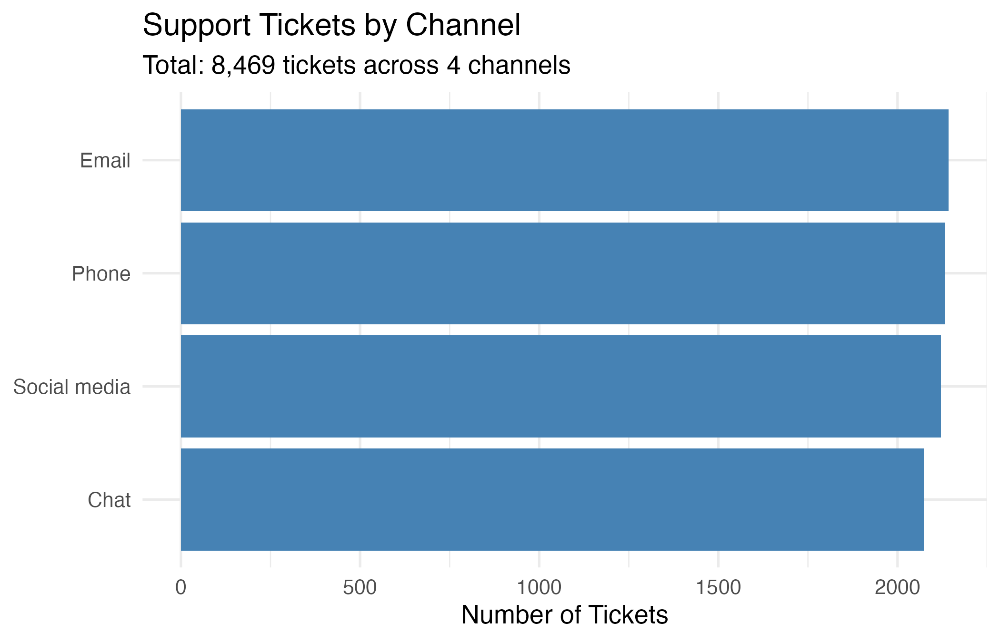

# What 8,469 support tickets reveal about demand and satisfaction

Email handled 2,143 tickets and phone handled 2,132. A support manager looking at those queues would see almost the same volume. Would the customer ratings tell a different story? I used R to examine both questions and found that the choice of denominator mattered more than the channel ranking.

## Who gets counted in a satisfaction score?

All 2,769 closed tickets had a satisfaction rating. The 2,819 open tickets and 2,881 awaiting a customer response had none. The mean rating of **2.99 out of 5** therefore describes about a third of the file. A team relying on that number alone would miss every customer still waiting for an outcome.

| Channel | Tickets |
| --- | ---: |
| Email | 2,143 |
| Phone | 2,132 |
| Social media | 2,121 |
| Chat | 2,073 |

Chat had the highest mean among rated tickets (3.083). Before changing how cases are routed, I would compare similar issues and priorities across channels and check the proportion closed in each. Ticket counts alone also leave out handling time, which matters for staffing.

## Where I would investigate first

Refund requests (1,752) and technical issues (1,747) were the two largest categories, separated by only five tickets. I would sample cases from both queues to find out what customers repeatedly needed help with and which requests required a second contact. That would give a team a basis for choosing between clearer refund updates and better troubleshooting guidance.



## Inspect or run the analysis

The [R script](analysis.R) cleans the column names, counts issue types, calculates channel-level satisfaction for rated tickets, and exports three charts. The [priority breakdown](tickets_by_priority.png) and [ten most frequently reported products](top_10_products.png) show two other ways to examine the queue. The repository includes the [analytical dataset](customer_support_tickets.csv). Its collection method and organisation are undocumented, which limits generalisation to a live service.

From the repository root, run:

```bash
Rscript -e 'install.packages(c("tidyverse", "janitor"), repos="https://cloud.r-project.org")'
Rscript analysis.R
```

To inspect the channel results in an R session, run `source("analysis.R")` and print `channel_summary`.
